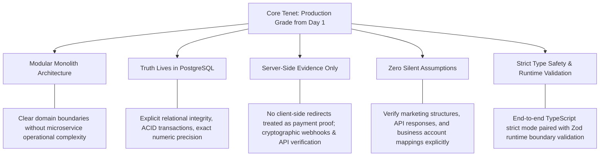
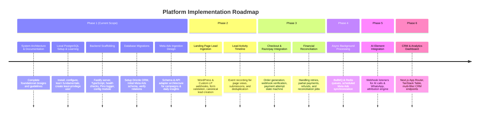

# 00. Project Overview: Enterprise Lead Management Platform

## 1. Executive Summary

The **Enterprise Lead Management Platform** is a centralized, high-reliability backend and database system designed to ingest, process, attribute, and manage commercial leads and customer conversion journeys across multiple marketing channels and business areas.

This platform powers a multi-vertical commercial operation spanning:
1. **Vastu Reports and Consultations** (Digital audits, residential/commercial consultations, premium custom reports).
2. **Webinars and Training Workshops** (High-volume paid/free interactive workshops, live cohorts, educational funnels).

The business acquires customers via paid advertising (**Meta Ads, Google Ads**) and direct outreach (**Bulk WhatsApp, Bulk Email**) driving traffic to both **WordPress landing pages** and **Custom-coded high-conversion landing pages**. Customers submit forms, enter checkout funnels, and process transactions through **Razorpay**. Downstream automation coordinates follow-ups via an **AI Element platform** (voice calls and conversational WhatsApp messaging), sales team handovers, and CRM workflows.

---

## 2. Core Philosophy & Architectural Tenets

### Tenet 1: Modular Monolith
Rather than introducing distributed microservices with high network latency, distributed transactions, and deployment friction, we build a **cohesive modular monolith** in Node.js / TypeScript. Every business domain (e.g., `meta-ads`, `leads`, `orders`, `payments`, `ai-interactions`) is organized in an isolated, self-contained directory with clear public interfaces. If any service ever needs to scale independently in the future, its extraction is straightforward.

### Tenet 2: The Database Is the Single Source of Truth
No business entity exists solely in memory or in ephemeral logs. PostgreSQL enforces schema rules, unique constraints, foreign keys, and transactional atomicity. Financial numbers **never** use floating-point types; they use PostgreSQL `NUMERIC` with explicit scale.

### Tenet 3: Trust Server Evidence, Not Client Claims
A frontend browser redirect or client-side "Success" alert is never accepted as payment or conversion confirmation. Payments are only confirmed via server-side cryptographic signature verification of Razorpay webhooks and direct server-to-server payment status verification.

### Tenet 4: Strict Separation of States
Real-world sales funnels are complex:
- A **Lead** can exist without an Order.
- An **Order** can exist without a Payment.
- An **Order** can have multiple **Payment Attempts** (e.g., first attempt failed due to bank timeout, second succeeded).
- An **Abandoned Checkout** is an observed session event, not an automatic payment failure.
- An **AI outreach attempt** must track delivery, pickup, engagement, and causal attribution separately from lead status.

---

## 3. Technology Stack Selection

| Layer | Selected Technology | Technical Justification |
| :--- | :--- | :--- |
| **Runtime** | **Node.js LTS (v22 / v24)** | High-throughput non-blocking I/O, vast ecosystem, unified TypeScript ecosystem across backend and future frontend. |
| **Language** | **TypeScript (Strict Mode)** | Compile-time type safety preventing `null`/`undefined` errors and structural mismatches across complex domain objects. |
| **HTTP Framework** | **Fastify** | 2x-4x faster throughput than Express, built-in schema compilation, first-class structured logging with Pino, plugin encapsulation architecture. |
| **Database** | **PostgreSQL (16+)** | World-class relational integrity, powerful JSONB indexing, robust ACID transactions, rich window functions for analytics and attribution. |
| **Data Access / ORM** | **Drizzle ORM** | Type-safe SQL-like query builder with zero runtime overhead, instant migrations via `drizzle-kit`, and explicit SQL control without Prisma's heavy engine binary. |
| **Validation** | **Zod** | Runtime boundary validation of incoming HTTP payloads, environment variables, and third-party API payloads. |
| **Logging** | **Pino** | High-performance asynchronous structured JSON logger integrated with Fastify, tracking request correlation IDs (`x-request-id`). |
| **Future Async Queue** | **BullMQ + Redis** | Reliable background job processing for high-volume webhook ingestion, Meta API sync schedules, and rate-limited retries. |

---

## 4. Implementation Phasing Strategy

---

## 5. Scope of Current Milestone (Phase 1)

This phase establishes the bedrock on which all future capabilities rest:
1. Complete system architecture documentation (13 dedicated architectural manuals).
2. Deep-dive PostgreSQL educational guide covering relational concepts from first principles.
3. Windows local PostgreSQL installation guidance and verification.
4. Clean backend scaffolding (Fastify + TypeScript strict + Zod + Pino).
5. Initial PostgreSQL database schema specifically for the first marketing ingestion target: **Meta Ads** (Business Units, Ad Accounts, Campaigns, Ad Sets, Ads, Daily Insights, and Sync Tracking).
6. Local migration execution and verification with synthetic sample queries.

**Explicit Scope Exclusions for Phase 1:**
- No frontend UI code.
- No live Razorpay transaction execution.
- No AI calling or WhatsApp integrations.
- No live production Meta API calls (until authentication credentials and schema are reviewed and validated).
