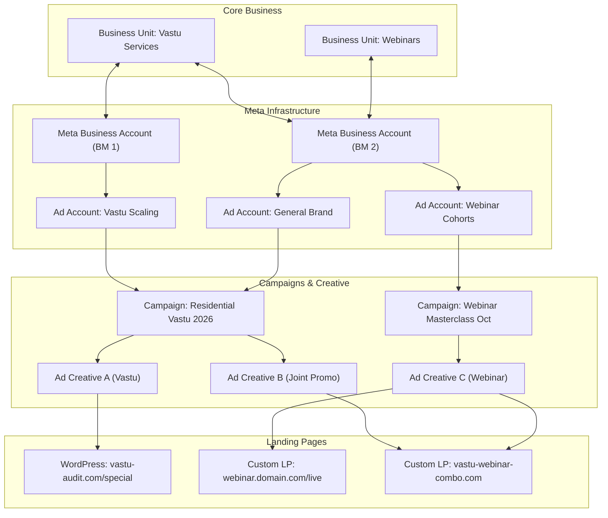
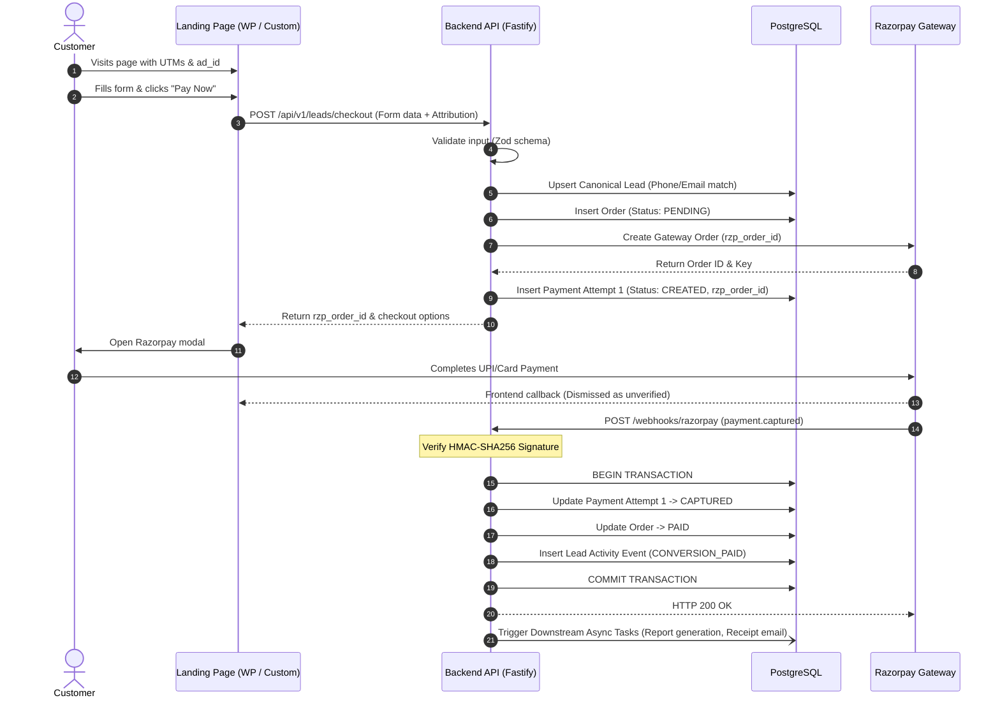
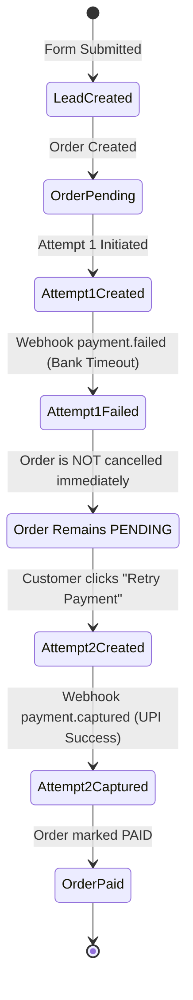
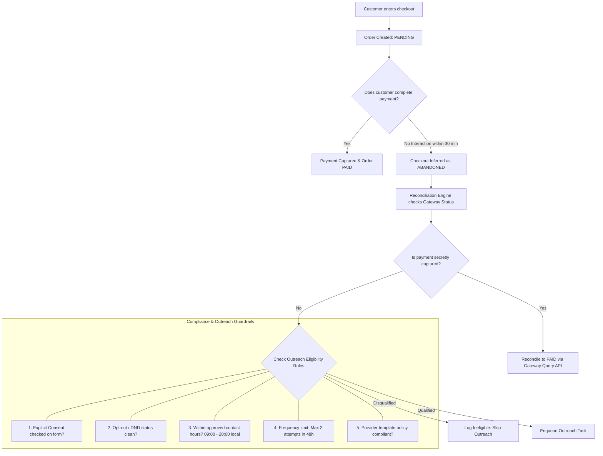
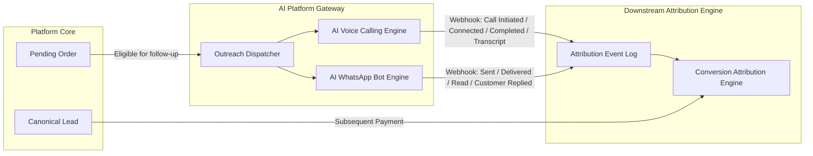

# 01. Business Requirements & Domain Specification

## 1. Business Context & Strategic Objectives

The business operates commercial digital sales funnels across two distinct primary **Business Units (BUs)**:
1. **Vastu Reports & Consultation Services**:
   - Offerings: Architectural floorplan audits, residential & commercial Vastu assessments, corrective remedy consultations, and bespoke premium PDF reports.
   - Profile: Higher average order value (AOV), longer decision consideration, personalized consultation scheduling, rigorous document collection (e.g. floorplans, compass directions).
2. **Webinars & Training Workshops**:
   - Offerings: Live cohort workshops, spiritual & architectural science bootcamps, masterclasses, and digital product bundles.
   - Profile: Lower unit price / high volume, time-sensitive registration deadlines, ticket issuance, rapid automated follow-up sequences.

### Marketing Source Categories
Traffic is driven via four primary channels:
1. **Meta Ads**: Facebook and Instagram feed, story, and reel placements.
2. **Google Ads**: Search intent keywords, Performance Max, and YouTube video funnels.
3. **Bulk WhatsApp Campaigns**: Targeted broadcast campaigns to opt-in audience lists.
4. **Bulk Email Campaigns**: Newsletter broadcasts, nurture sequences, and discount announcements.

### Landing Page Types
1. **WordPress Landing Pages**: Built using Elementor or block builders, hosting lead capture plugins or custom scripts.
2. **Custom-Coded Landing Pages**: Fast, bespoke React / HTML / Next.js static pages with embedded API-driven forms and checkout scripts.

---

## 2. Structural Mapping: Non-Linear Entity Relationships

> [!WARNING] Architectural Trap: Never Assume 1-to-1 Mappings
> In amateur CRM designs, developers assume:
> `1 Business Unit = 1 Meta Business Manager = 1 Ad Account = 1 Landing Page`.
> In reality, marketing structures are fluid and many-to-many.

### Relational Rules
1. A **Business Unit** may own or leverage multiple **Meta Business Managers** or **Ad Accounts**.
2. A single **Ad Account** may run campaigns serving Vastu or Webinars (or joint crossover bundles).
3. A single **Landing Page** may receive traffic from multiple ad accounts, Google Ads, WhatsApp broadcasts, and email links simultaneously.
4. Every lead capture event must store **explicit source parameters** (UTM tags, `meta_ad_id`, `campaign_id`, `landing_page_id`) rather than guessing origin from page domain or account name alone.

---

## 3. Customer & Payment Lifecycle Scenarios

### Scenario A: Clean Conversion (Happy Path)

**Key Invariant**: Under no circumstance is a client-side callback (`handler(response)`) treated as financial truth. Frontend callbacks merely instruct the browser to display a "Verifying your payment..." loading state while polling the backend or awaiting the server-side webhook.

---

### Scenario B: Payment Failure and Successful Retry

Customers frequently experience failed payments due to insufficient funds, bank server timeouts, UPI app dropoffs, or OTP expiry.

#### Relational Multiplicities
- **1 Lead** $\to$ **Many Orders** (A customer can purchase a Vastu audit today and a Webinar next month).
- **1 Order** $\to$ **Many Payment Attempts** (Attempt 1 = Failed, Attempt 2 = Failed, Attempt 3 = Captured).
- Historical attempts must **never be overwritten or deleted**. They represent financial audit logs and reveal payment gateway dropoff analytics.
- Retries must **never generate duplicate leads** or double-count marketing conversions.

---

### Scenario C: Checkout Abandonment & Regulatory Outreach Funnel

#### Distinguishing Inferred vs Observed Abandonment
- An abandoned checkout rarely sends a `payment.failed` event from Razorpay if the user simply closes the browser tab.
- Therefore, the system distinguishes:
  1. **Observed Failure**: Razorpay fired a verified `payment.failed` webhook with an error code (e.g., `BAD_REQUEST_ERROR`, `PAYMENT_CANCELLED_BY_USER`).
  2. **Inferred Abandonment**: The checkout session expired with zero webhook activity after a configurable window (e.g., 30 minutes).

---

## 4. AI Element Platform Integration Boundaries

The business employs an AI Element platform capable of outbound conversational voice calls and dynamic WhatsApp messaging.

### Attribution Models & Disclaimers
1. **Never Assume Simple Correlation Equals Causation**: If an AI call was completed at 10:00 AM and the user paid at 10:30 AM, this is an **AI-Assisted Conversion**, not indisputable causal proof.
2. The platform logs three distinct attribution tiers:
   - **First-Touch / Last-Touch Source**: Purely ad/campaign based (e.g. Meta Ad X).
   - **Assisted Interactions**: Any AI call, WhatsApp message, or human agent call occurring between order creation and payment capture.
   - **Causal Lift (Controlled Experimentation)**: Future capability utilizing randomized holdout groups (A/B testing where group B receives no AI outreach) to determine true incremental lift.

---

## 5. Future CRM & Operational Capabilities

The future CRM layer will serve internal sales reps, support agents, marketing analysts, and business leadership.

### Filtering & Query Invariants
- Filters must be implemented as **validated, indexed backend query parameters** running against optimized PostgreSQL indices.
- Prohibited: Creating distinct API endpoints for every permutation (e.g. `/leads-by-vastu`, `/leads-by-webinar`, `/leads-paid-today`).
- Required: Single standard endpoint `GET /api/v1/leads` accepting composed filter parameters:
  - `business_unit_id` (UUID)
  - `marketing_source` (Enum: `META_ADS`, `GOOGLE_ADS`, `WHATSAPP`, `EMAIL`)
  - `campaign_id` (UUID / String)
  - `landing_page_id` (UUID / String)
  - `lead_status` (Enum: `NEW`, `CONTACTED`, `QUALIFIED`, `CONVERTED`, `LOST`, `UNRESPONSIVE`)
  - `payment_status` (Enum: `UNPAID`, `PENDING`, `PARTIALLY_PAID`, `PAID`, `REFUNDED`)
  - `assigned_agent_id` (UUID)
  - `date_from` & `date_to` (ISO 8601 UTC)
  - `page`, `page_size`, `sort_by`, `sort_order`

### Separation of Distinct Operational States

| Entity | State Field | Permitted Values | Meaning |
| :--- | :--- | :--- | :--- |
| **Lead** | `lifecycle_stage` | `PROSPECT`, `MQL`, `SQL`, `CUSTOMER`, `CHURNED` | Commercial relationship with the brand |
| **Order** | `status` | `DRAFT`, `PENDING`, `PAID`, `EXPIRED`, `CANCELLED`, `REFUNDED` | Financial commitment state |
| **Payment Attempt** | `status` | `CREATED`, `AUTHORIZED`, `CAPTURED`, `FAILED`, `DISPUTED` | Gateway transaction attempt state |
| **Checkout Session** | `state` | `ACTIVE`, `ABANDONED`, `COMPLETED`, `TIMED_OUT` | User interaction session status |
| **Outreach Task** | `status` | `QUEUED`, `IN_PROGRESS`, `CONNECTED`, `NO_ANSWER`, `FAILED`, `SUPPRESSED` | Telephony/WhatsApp dispatch status |

---

## 6. Requirements Classification

### Confirmed Requirements
1. Two business areas: Vastu Reports & Consultations, Webinars & Workshops.
2. Initial ingestion priority: **Meta Ads marketing data**.
3. Strict separation of marketing entities (Business Units, Ad Accounts, Campaigns, Ad Sets, Ads, Landing Pages).
4. Safe financial recording using exact decimal types; no float values for currency.
5. Absolute refusal of client-side payment verification.

### Documented Assumptions
1. Meta Graph API will be queried using System User Access Tokens rather than short-lived user tokens.
2. Ad spend is billed in INR or USD depending on the specific ad account configuration; currency must be stored alongside values.
3. Leads are identified canonically by normalized E.164 phone number as primary key and email address as secondary key.

### Open Questions for Business Clarification (To address in later phases)
1. What are the exact Meta Business Manager IDs and Ad Account IDs currently active for each business unit?
2. What are the specific Razorpay merchant account setups (single shared merchant account with route transfers vs separate key pairs per business unit)?
3. What are the specific consent checkboxes currently implemented on the WordPress and custom landing pages?
