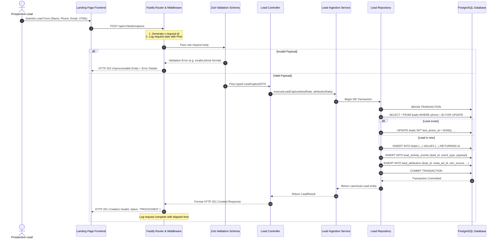
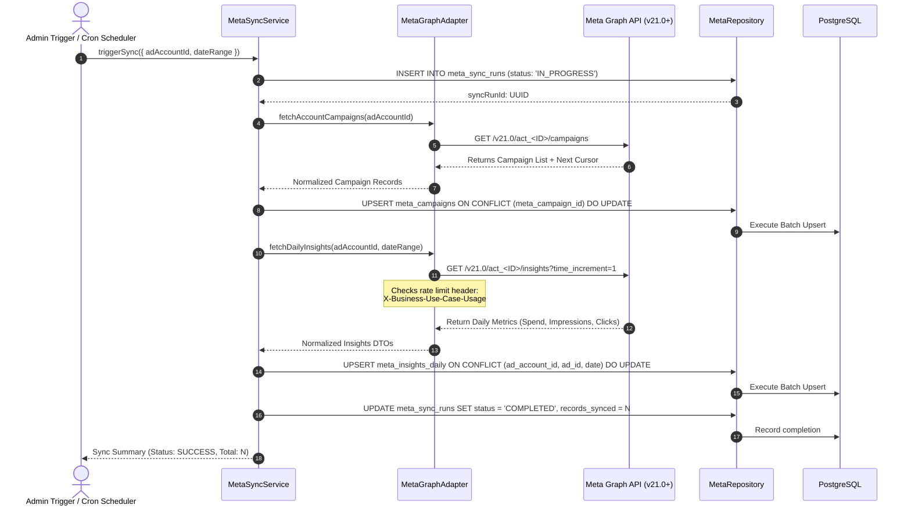

# 02. System Architecture: Modular Monolith

## 1. High-Level Architecture Overview

The backend is architected as a **Modular Monolith**. It runs as a single unified Node.js process, but its internal code is strictly partitioned into high-cohesion, low-coupling domain modules.

```mermaid
graph TB
    subgraph Clients & Third Parties
        LP[Landing Pages: WP & Custom]
        META[Meta Graph API]
        RZP[Razorpay Webhooks]
        CRM_FE[Future CRM Web App]
    end

    subgraph Fastify HTTP & Network Layer
        CORS[CORS & Helmet]
        REQ_ID[Correlation ID: x-request-id]
        PINO[Pino Request Logger]
        RATE[Rate Limiter]
        ROUTER[Fastify URL Router]
    end

    subgraph Application Modules (Domain Boundaries)
        subgraph MetaAdsModule["meta-ads module"]
            M_CTRL[Meta Controller]
            M_SRV[Meta Sync Service]
            M_ADAPT[Meta Graph API Adapter]
            M_REPO[Meta Repository]
        end

        subgraph LeadsModule["leads module (Phase 2)"]
            L_CTRL[Leads Controller]
            L_SRV[Lead Ingestion Service]
            L_REPO[Lead Repository]
        end

        subgraph OrdersModule["orders & payments module (Phase 3)"]
            O_CTRL[Order/Payment Controller]
            O_SRV[Payment Lifecycle Service]
            O_REPO[Order & Attempt Repository]
        end

        subgraph SharedCore["core / shared"]
            CONF[Config Module: Zod Env]
            ERR[Global Error Handler: RFC 7807]
            DB_CLIENT[Drizzle ORM & PG Pool]
        end
    end

    subgraph Data & Queue Layer
        PG[(PostgreSQL Database)]
        REDIS[(Redis & BullMQ - Phase 4)]
    end

    LP --> CORS
    META --> M_ADAPT
    RZP --> CORS
    CRM_FE --> CORS

    CORS --> REQ_ID --> PINO --> RATE --> ROUTER

    ROUTER --> M_CTRL
    ROUTER --> L_CTRL
    ROUTER --> O_CTRL

    M_CTRL --> M_SRV --> M_ADAPT
    M_SRV --> M_REPO --> DB_CLIENT

    L_CTRL --> L_SRV --> L_REPO --> DB_CLIENT
    O_CTRL --> O_SRV --> O_REPO --> DB_CLIENT

    DB_CLIENT --> PG
    M_SRV -.-> REDIS
```

---

## 2. Layer-by-Layer Architectural Decomposition

### 1. HTTP / Network Layer (Fastify Framework)
- **Responsibilities**: Accepts incoming TCP/HTTP connections, negotiates TLS/SSL, parses headers and incoming JSON streams, applies security headers (Helmet), enforces Cross-Origin Resource Sharing (CORS), and assigns every request a globally unique `x-request-id`.
- **Why It Exists**: Decouples network-level concerns (ports, protocols, raw byte parsing) from business logic. Fastify provides unmatched throughput with negligible overhead.

### 2. Validation Layer (Zod Schemas)
- **Responsibilities**: Inspects all input data (URL route parameters, query strings, request bodies, headers) before any controller logic executes. Rejects invalid formats immediately with HTTP 400 Bad Request.
- **Why It Exists**: Never trust client inputs. Unvalidated inputs cause SQL injection, buffer overflows, unexpected `null` dereferences, and corrupted database state.

### 3. Controllers
- **Responsibilities**: Unpack validated HTTP parameters, invoke the corresponding domain service methods, format the service return values into consistent HTTP responses, and map domain errors to HTTP status codes.
- **Why It Exists**: Keeps HTTP concerns (status codes, headers, cookie management) separate from core business rules. A service method should never take a raw `FastifyRequest` or `FastifyReply`.

### 4. Service / Business Logic Layer
- **Responsibilities**: Encapsulates all domain workflows, transaction orchestration, state machines, validation of business invariants (e.g. "Can this order transition from PENDING to PAID?"), and calls to external integration adapters.
- **Why It Exists**: This is the heart of the application. It contains the business rules. It is completely independent of HTTP and can be executed via CLI scripts, cron jobs, or message queues without changing a single line of business code.

### 5. Repository / Database Access Layer (Drizzle ORM)
- **Responsibilities**: Executes concrete SQL queries, inserts, updates, and transaction blocks. Translates relational database rows into TypeScript domain objects.
- **Why It Exists**: Isolates database dialect and query construction from business logic. If a query needs performance tuning or index optimization, changes are made in the repository without altering service logic.

### 6. The Relational Database (PostgreSQL 16+)
- **Responsibilities**: Stores the authoritative business data, enforces relational integrity (`FOREIGN KEY`), prevents duplicates (`UNIQUE`), ensures transactional durability (`ACID`), and indexes search fields.
- **Why It Exists**: In-memory state and application servers are transient and can crash or restart. PostgreSQL provides persistent, durable, auditable ground truth.

### 7. Database Migrations Engine (`drizzle-kit`)
- **Responsibilities**: Version-controls the database schema through sequential, deterministic SQL files. Tracks which migrations have run on any given environment.
- **Why It Exists**: Prevents "works on my machine" database discrepancies. Ensures development, staging, and production databases always have an identical schema.

### 8. Configuration & Secrets Manager
- **Responsibilities**: Reads environment variables from `.env` files or the host OS, parses and validates them through a strict Zod schema at application boot, and halts startup immediately if any required variable is missing or malformed.
- **Why It Exists**: Prevents runtime crashes midway through production execution due to missing API keys or database connection strings.

### 9. Logging & Observability (Pino)
- **Responsibilities**: Emits structured JSON logs containing timestamp, level (`info`, `warn`, `error`), message, correlation ID (`reqId`), execution duration, and contextual metadata.
- **Why It Exists**: Plain text console logs (`console.log`) are impossible to parse and search at scale. Structured JSON allows log aggregation tools (Datadog, Grafana Loki, CloudWatch) to filter errors instantly.

### 10. External Integration Adapters
- **Responsibilities**: Encapsulates external third-party HTTP APIs (Meta Graph API, Razorpay API, AI Element API). Handles third-party authentication tokens, exponential backoff retries, rate-limit headers, and converts external response formats into our internal domain models.
- **Why It Exists**: Third-party APIs change frequently. Wrapping them in adapters shields our internal business logic from third-party breaking changes.

---

## 3. End-to-End Request Lifecycle: Landing Page Form Submission

The following sequence details how a future lead capture request moves through all layers:



---

## 4. Meta Ads Synchronization Integration Flow

The Meta Marketing API ingestion process runs independently of customer-facing HTTP requests. In Phase 1, it can be triggered on-demand via a protected administrative endpoint or CLI script; in Phase 4, it will be orchestrated by BullMQ scheduled cron workers.



---

## 5. Architectural Decision: Why Modular Monolith?

| Architectural Pattern | Operational Complexity | Network Overhead | Data Consistency | Fit for Our Project Stage |
| :--- | :--- | :--- | :--- | :--- |
| **Microservices** | **Very High**: Requires Docker orchestration, Kubernetes, API Gateways, service meshes, distributed tracing, distributed transaction compensation (Saga pattern). | **High**: Constant inter-service HTTP/gRPC network hops. | **Eventual**: Eventual consistency leads to financial reconciliation nightmare. | **Unsuitable**: Premature distribution introduces operational drag without business justification. |
| **Traditional Unstructured Monolith** | **Low**: Single project. | **Zero**: In-memory function calls. | **High**: Single ACID DB. | **Fragile**: "Spaghetti code" where business logic directly manipulates database tables without boundaries. |
| **Modular Monolith (Selected)** | **Low to Medium**: Single deployable artifact, single clean codebase, shared database connection pool. | **Zero**: Modules communicate via typed in-memory interfaces. | **Guaranteed**: Full ACID transactions across modules in PostgreSQL. | **Optimal**: High architectural hygiene, rapid feature iteration, clear boundary isolation. |
