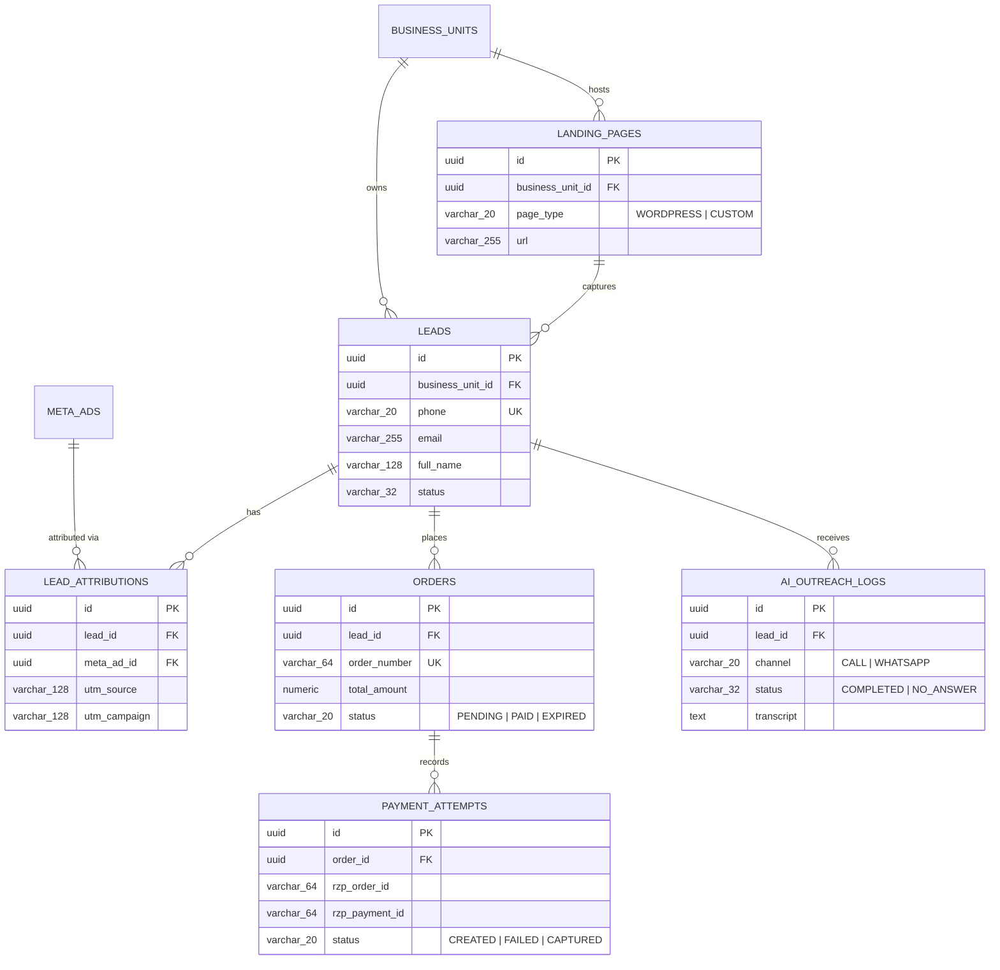

# 06. Entity Relationship Diagram (ERD)

## 1. Phase 1 Entity Relationship Diagram

The diagram below documents the physical database schema for the Phase 1 Meta Ads Ingestion milestone.

```mermaid
erDiagram
    BUSINESS_UNITS ||--o{ META_BUSINESS_ACCOUNTS : "associated with"
    BUSINESS_UNITS ||--o{ META_AD_ACCOUNTS : "funded / owned by"
    META_BUSINESS_ACCOUNTS ||--o{ META_AD_ACCOUNTS : "manages"
    META_AD_ACCOUNTS ||--o{ META_CAMPAIGNS : "contains"
    META_CAMPAIGNS ||--o{ META_AD_SETS : "partitions"
    META_AD_SETS ||--o{ META_ADS : "delivers"
    META_ADS ||--o{ META_INSIGHTS_DAILY : "accumulates"
    META_AD_ACCOUNTS ||--o{ META_SYNC_RUNS : "audits"
    META_SYNC_RUNS ||--o{ META_SYNC_ERRORS : "records"

    BUSINESS_UNITS {
        uuid id PK
        varchar_32 code UK
        varchar_128 name
        text description
        varchar_20 status
        timestamptz created_at
        timestamptz updated_at
    }

    META_BUSINESS_ACCOUNTS {
        uuid id PK
        uuid business_unit_id FK
        varchar_64 meta_bm_id UK
        varchar_128 name
        varchar_32 verification_status
        timestamptz created_at
        timestamptz updated_at
    }

    META_AD_ACCOUNTS {
        uuid id PK
        uuid meta_bm_id FK
        uuid business_unit_id FK
        varchar_64 meta_account_id UK
        varchar_128 name
        varchar_3 currency
        varchar_64 timezone_name
        integer account_status
        timestamptz created_at
        timestamptz updated_at
    }

    META_CAMPAIGNS {
        uuid id PK
        uuid ad_account_id FK
        varchar_64 meta_campaign_id UK
        varchar_255 name
        varchar_64 objective
        varchar_32 status
        numeric daily_budget
        numeric lifetime_budget
        timestamptz created_at
        timestamptz updated_at
    }

    META_AD_SETS {
        uuid id PK
        uuid campaign_id FK
        varchar_64 meta_ad_set_id UK
        varchar_255 name
        varchar_32 status
        numeric daily_budget
        varchar_64 optimization_goal
        timestamptz created_at
        timestamptz updated_at
    }

    META_ADS {
        uuid id PK
        uuid ad_set_id FK
        varchar_64 meta_ad_id UK
        varchar_255 name
        varchar_32 status
        varchar_64 creative_id
        text creative_url
        timestamptz created_at
        timestamptz updated_at
    }

    META_INSIGHTS_DAILY {
        uuid id PK
        uuid ad_id FK
        date date
        numeric spend
        varchar_3 currency
        bigint impressions
        bigint clicks
        bigint inline_link_clicks
        integer leads_reported_by_meta
        integer conversions_reported_by_meta
        numeric cpc
        numeric cpm
        numeric ctr
        timestamptz created_at
        timestamptz updated_at
    }

    META_SYNC_RUNS {
        uuid id PK
        uuid ad_account_id FK
        varchar_32 sync_type
        date date_range_start
        date date_range_end
        varchar_32 status
        integer records_processed
        timestamptz started_at
        timestamptz completed_at
        timestamptz created_at
    }

    META_SYNC_ERRORS {
        uuid id PK
        uuid sync_run_id FK
        varchar_64 error_code
        text error_message
        text error_stack
        jsonb raw_payload
        timestamptz created_at
    }
```

---

## 2. Foreign Key Actions & Deletion Behaviors

| Foreign Key Relationship | Constraint Action | Architectural Justification |
| :--- | :--- | :--- |
| `meta_business_accounts.business_unit_id` $\to$ `business_units.id` | `ON DELETE SET NULL` | If a business unit is reorganized or archived, we must never delete the underlying historical ad accounts or Meta BMs. |
| `meta_ad_accounts.business_unit_id` $\to$ `business_units.id` | `ON DELETE SET NULL` | Ad account records and financial logs must be preserved even if commercial categories shift. |
| `meta_campaigns.ad_account_id` $\to$ `meta_ad_accounts.id` | `ON DELETE CASCADE` | Campaigns strictly belong to their parent Ad Account. Deleting an account in development cascade-cleans its campaigns. |
| `meta_ad_sets.campaign_id` $\to$ `meta_campaigns.id` | `ON DELETE CASCADE` | Ad Sets have no existence outside their parent campaign. |
| `meta_ads.ad_set_id` $\to$ `meta_ad_sets.id` | `ON DELETE CASCADE` | Ad creatives belong to their parent ad set. |
| `meta_insights_daily.ad_id` $\to$ `meta_ads.id` | `ON DELETE CASCADE` | Daily metrics are children of the ad creative. |
| `meta_sync_errors.sync_run_id` $\to$ `meta_sync_runs.id` | `ON DELETE CASCADE` | Error logs are tied directly to the execution run. |

---

## 3. High-Level Vision: Future Entity Extensions (Phase 2 & 3)

The diagram below illustrates how future entities will attach to the Phase 1 foundation:

