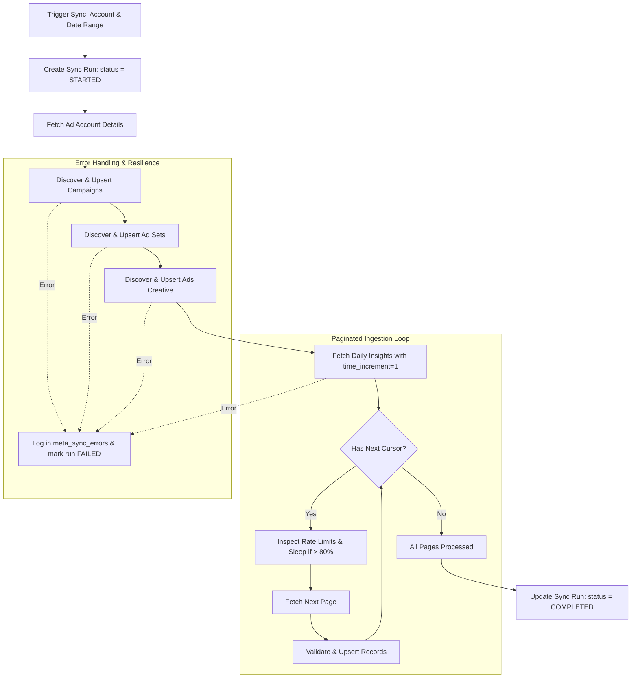

# 07. Meta Ads Ingestion Architecture & Engineering Specification

## 1. Meta Marketing API Fundamentals

The synchronization engine extracts campaign structures and performance analytics from the **Meta Graph API** (targeted at version `v21.0` / `v22.0`).



---

## 2. Meta App Configuration & Required Permissions

To read marketing data from Meta, the system uses a **System User Access Token** generated inside Meta Business Manager, not a personal user's temporary token.

### Why a System User Token?
- Personal user tokens expire every 60 days and break unexpectedly when an employee resets their personal Facebook password or enables 2FA.
- System User Tokens are permanent programmatic service accounts tied directly to the Business Manager.

### Required Graph API Scopes
1. `ads_read`: Grants read-only access to campaigns, ad sets, ads, creatives, and ad account settings.
2. `read_insights`: Grants access to aggregate performance metrics (spend, impressions, clicks, conversions).
3. `business_management`: Allows programmatic discovery of all ad accounts associated with the Business Manager.

---

## 3. Endpoints and Field Mapping

### 1. Ad Account Discovery
- **Endpoint**: `GET https://graph.facebook.com/v21.0/me/adaccounts`
- **Fields**: `id,account_id,name,currency,timezone_name,account_status,business`

### 2. Campaigns
- **Endpoint**: `GET https://graph.facebook.com/v21.0/act_<AD_ACCOUNT_ID>/campaigns`
- **Fields**: `id,name,objective,status,daily_budget,lifetime_budget,created_time,updated_time`

### 3. Ad Sets
- **Endpoint**: `GET https://graph.facebook.com/v21.0/act_<AD_ACCOUNT_ID>/adsets`
- **Fields**: `id,campaign_id,name,status,daily_budget,optimization_goal`

### 4. Ads
- **Endpoint**: `GET https://graph.facebook.com/v21.0/act_<AD_ACCOUNT_ID>/ads`
- **Fields**: `id,adset_id,name,status,creative{id,object_story_spec,asset_feed_spec}`

### 5. Daily Insights
- **Endpoint**: `GET https://graph.facebook.com/v21.0/act_<AD_ACCOUNT_ID>/insights`
- **Query Parameters**:
  - `level=ad` (Grain: per ad creative)
  - `time_increment=1` (Grain: daily breakdown)
  - `time_range={'since':'2026-10-01','until':'2026-10-27'}`
  - `fields=ad_id,ad_name,spend,impressions,clicks,inline_link_clicks,actions,cost_per_inline_link_click,cpm,ctr,date_start`

---

## 4. Rate Limiting, Throttling & Header Inspection

Meta enforces strict rate limits across two header namespaces:
1. `X-App-Usage`: Application-level usage (`call_count`, `total_cputime`, `total_time`).
2. `X-Business-Use-Case-Usage`: Specific Business Manager and Ad Account usage limits.

### Header Format Example
```json
{
  "X-Business-Use-Case-Usage": "{
    \"1029384756\": [
      {
        \"call_count\": 45,
        \"total_cputime\": 22,
        \"total_time\": 30,
        \"estimated_time_to_regain_access\": 0
      }
    ]
  }"
}
```

### Proactive Throttling Algorithm
```typescript
function inspectMetaRateLimits(headers: Headers): void {
  const usageHeader = headers.get('x-business-use-case-usage');
  if (!usageHeader) return;

  const usage = JSON.parse(usageHeader);
  for (const accountId in usage) {
    const metrics = usage[accountId][0];
    const maxUtilization = Math.max(metrics.call_count, metrics.total_cputime, metrics.total_time);

    if (maxUtilization > 80) {
      const waitMinutes = metrics.estimated_time_to_regain_access || 5;
      logger.warn({ accountId, maxUtilization, waitMinutes }, 'Approaching Meta API rate limit; throttling requests');
      // Pause worker execution
      sleep(waitMinutes * 60 * 1000);
    }
  }
}
```

---

## 5. Cursor-Based Pagination Implementation

Meta Graph API paginates data using cursors. Our adapter consumes pages until `paging.next` is absent:

```typescript
async function* fetchAllPages<T>(initialUrl: string, accessToken: string): AsyncGenerator<T[]> {
  let nextUrl: string | undefined = initialUrl;

  while (nextUrl) {
    const response = await fetch(nextUrl, {
      headers: { Authorization: `Bearer ${accessToken}` },
    });

    if (!response.ok) {
      const errorPayload = await response.json();
      throw new MetaApiError(response.status, errorPayload);
    }

    const payload = await response.json();
    yield payload.data as T[];

    nextUrl = payload.paging?.next;
    if (nextUrl) {
      // Respectful delay to prevent bursting
      await sleep(250);
    }
  }
}
```

---

## 6. Timezone Handling & Reporting Grain

- **The Problem**: A customer in Delhi clicks an ad at 11:30 PM IST on Oct 27. The UTC server clock reads 6:00 PM UTC on Oct 27. However, an ad account set to `America/New_York` records that click at 2:00 PM EST on Oct 27.
- **The Solution**:
  1. Meta Ad Accounts always report daily metrics aligned to the **Ad Account's configured timezone**, not the server's UTC clock.
  2. The `date` column in `meta_insights_daily` stores the `date_start` string as reported by the Ad Account API (e.g., `2026-10-27`).
  3. All system tracking timestamps (`created_at`, `updated_at`, `started_at`) are strictly stored in UTC (`TIMESTAMPTZ`).

---

## 7. Idempotent Upserts (PostgreSQL `ON CONFLICT`)

Running a sync job twice for the same date range must **never create duplicate rows** or double total spend.

```sql
INSERT INTO meta_insights_daily (
    ad_id,
    date,
    spend,
    currency,
    impressions,
    clicks,
    inline_link_clicks,
    cpc,
    cpm,
    ctr,
    updated_at
) VALUES (
    $1, $2, $3, $4, $5, $6, $7, $8, $9, $10, NOW()
)
ON CONFLICT (ad_id, date) DO UPDATE SET
    spend = EXCLUDED.spend,
    currency = EXCLUDED.currency,
    impressions = EXCLUDED.impressions,
    clicks = EXCLUDED.clicks,
    inline_link_clicks = EXCLUDED.inline_link_clicks,
    cpc = EXCLUDED.cpc,
    cpm = EXCLUDED.cpm,
    ctr = EXCLUDED.ctr,
    updated_at = NOW();
```

---

## 8. Payload Auditing & Credential Security

- **Rule 1**: Meta Access Tokens must **never** appear in log files, database error stacks, or git repositories.
- **Rule 2**: When recording `raw_payload` in `meta_sync_errors`, all sensitive tokens, secret app IDs, or customer PII are redacted using a sanitized copy:
  ```typescript
  function sanitizePayload(payload: any): any {
    const copy = { ...payload };
    if (copy.access_token) copy.access_token = '[REDACTED]';
    if (copy.appsecret_proof) copy.appsecret_proof = '[REDACTED]';
    return copy;
  }
  ```
