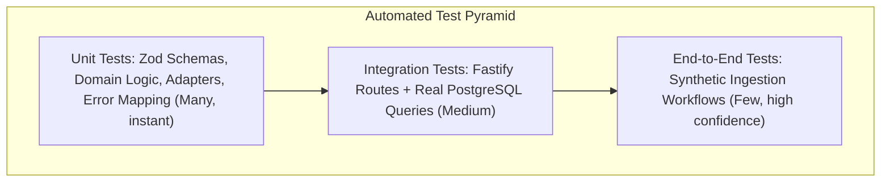

# 10. Testing Strategy & Quality Assurance

## 1. Quality Assurance Philosophy

In production software, untyped or untested code is technical debt with high interest. Our testing strategy ensures every layer of the modular monolith can be verified independently and automatically.



---

## 2. Test Suite Classification

### 1. Unit Tests
- **Target**: Pure TypeScript functions, Zod validation schemas, data transformation mappers, and error formatting.
- **Execution Speed**: < 5 milliseconds per test.
- **Dependencies**: No database, no network calls. External HTTP calls are mocked.
- **Example**: Validating that `SyncRequestSchema` rejects invalid date strings like `"28-10-2026"` and accepts `"2026-10-28"`.

### 2. Integration Tests
- **Target**: Fastify route handlers, authentication hooks, and Drizzle ORM repository queries against a real PostgreSQL database.
- **Isolation**: Runs against a dedicated `lead_management_test` database.
- **Tool**: Fastify's native `app.inject()` (bypasses TCP network overhead for speed while running complete HTTP middleware pipelines).
- **Example**: Verifying that inserting a duplicate daily insight row executes an `ON CONFLICT` update rather than throwing a duplicate key exception.

### 3. End-to-End Synthetic Scenarios
- **Target**: Full multi-step workflows using deterministic mock adapters.
- **Example**: Simulating an entire Meta ad account sync run from initial API response mocking to database insertion and sync run status verification.

---

## 3. Test Runner & Tooling Selection

| Tool | Purpose | Justification |
| :--- | :--- | :--- |
| **Vitest** | Test Runner & Assertion Library | Native TypeScript support without complex Babel or `ts-jest` compilation; extremely fast execution with worker threads. |
| **Fastify `app.inject()`** | HTTP Endpoint Simulation | Allows executing real HTTP requests into Fastify without spinning up live TCP network sockets. |
| **Testcontainers or Dedicated Test DB** | Database Isolation | Ensures test runs execute real PostgreSQL SQL statements without touching development data. |

---

## 4. Test Isolation & Database Cleanup Pattern

To prevent test interference, every integration test suite executes inside an isolated transaction or cleans up created rows using a truncation hook:

```typescript
// tests/integration/setup.ts
import { db } from '../../src/core/database';
import { sql } from 'drizzle-orm';

beforeEach(async () => {
  // Truncate test tables before each integration test
  await db.execute(sql`
    TRUNCATE TABLE 
      meta_insights_daily, 
      meta_ads, 
      meta_ad_sets, 
      meta_campaigns, 
      meta_ad_accounts, 
      meta_business_accounts, 
      business_units 
    RESTART IDENTITY CASCADE;
  `);
});
```

---

## 5. Synthetic Fixture Library

Real customer or financial data is **never used in test suites**. Deterministic synthetic fixtures are maintained in `tests/fixtures/`:
- `meta-campaigns-mock.json`: Realistic Meta Graph API payload containing sample campaigns.
- `meta-insights-mock.json`: Realistic daily performance metrics.
- `razorpay-captured-webhook.json`: Simulated Razorpay payment capture payload with valid HMAC test signatures.
