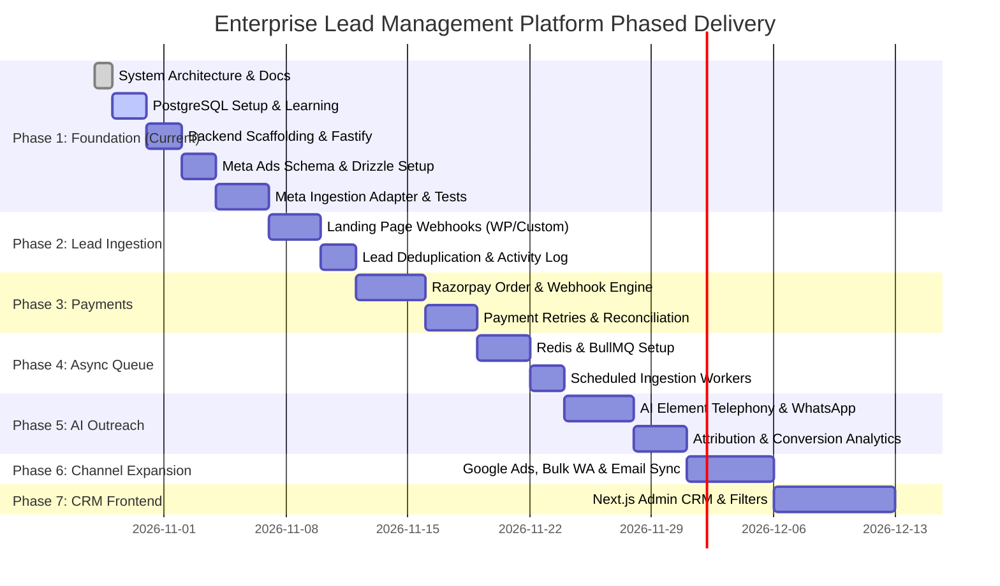

# 11. Future Implementation Roadmap & Phased Milestones

## 1. Multi-Phase Implementation Plan

---

## 2. Detailed Phase Specifications

### Phase 1: Backend Foundation & Meta Ads Ingestion (Current Scope)
- **Objective**: Establish the bedrock architecture, install and configure local PostgreSQL, set up Fastify + TypeScript + Drizzle ORM, implement the initial Meta Ads data ingestion model, and verify with synthetic tests.
- **Deliverables**:
  - Full architectural documentation.
  - Working local PostgreSQL instance (`lead_management_dev`).
  - Executable Fastify server with health checks, Pino logger, and Zod configuration.
  - Drizzle ORM schema for `business_units`, `meta_campaigns`, `meta_ads`, `meta_insights_daily`, and sync audit tables.
  - Fully tested Meta API adapter and repository upsert logic.

---

### Phase 2: Landing Page Lead Ingestion & Attribution
- **Objective**: Capture prospective customer form submissions from WordPress and Custom Landing Pages into a unified Canonical Lead registry.
- **Deliverables**:
  - `POST /api/v1/leads/capture` endpoint accepting form inputs + UTM attribution.
  - WordPress webhook receiver plugin / script.
  - Canonical lead deduplication algorithm (matching E.164 phone numbers and normalized emails).
  - `lead_activity_events` audit trail recording page visits, form submissions, and status transitions.

---

### Phase 3: Payment Lifecycle & Razorpay Processing
- **Objective**: Implement robust, verified financial order and payment workflows supporting Scenarios A (success), B (retry), and C (abandonment).
- **Deliverables**:
  - Razorpay order creation and checkout session orchestration.
  - Webhook listener with HMAC-SHA256 cryptographic verification.
  - Payment attempt state machine (`CREATED` $\to$ `FAILED` or `CAPTURED`).
  - Order status transitions and automated reconciliation cron for uncaptured checkouts.

---

### Phase 4: Asynchronous Processing & Background Queues
- **Objective**: Offload heavy API syncs, webhook retries, and scheduled jobs from the HTTP request thread.
- **Deliverables**:
  - Redis connection and BullMQ queue infrastructure.
  - Nightly scheduled Meta Ads insight synchronization worker.
  - Retry queues with exponential backoff for failed webhook deliveries.

---

### Phase 5: AI Element Platform & Conversion Attribution
- **Objective**: Integrate with outbound AI voice calling and conversational WhatsApp platform with attribution evidence preservation.
- **Deliverables**:
  - Dispatcher service evaluating outreach eligibility rules (consent, DND, contact hours, frequency limits).
  - Inbound webhook receivers for call transcripts, connection status, and WhatsApp message read receipts.
  - Conversion attribution engine distinguishing assisted interactions vs rule-based attribution vs causal lift.

---

### Phase 6: Marketing Channel Expansion
- **Objective**: Ingest data from Google Ads, Bulk WhatsApp broadcasts, and Bulk Email marketing systems into the standardized attribution warehouse.
- **Deliverables**:
  - Google Ads API reporting adapter.
  - WhatsApp broadcast delivery & response ingestion.
  - Bulk email open/click tracking ingestion.

---

### Phase 7: CRM Admin Dashboard & Advanced Querying
- **Objective**: Deliver a web interface for marketing leadership, sales reps, and customer support.
- **Deliverables**:
  - Next.js (App Router) + React + Tailwind CSS + shadcn/ui.
  - TanStack Table with server-side pagination, sorting, and multi-filter queries.
  - Unified lead detail page with chronological activity timeline and payment history.
  - Role-Based Access Control (Admin, Sales Rep, Marketing Analyst).
