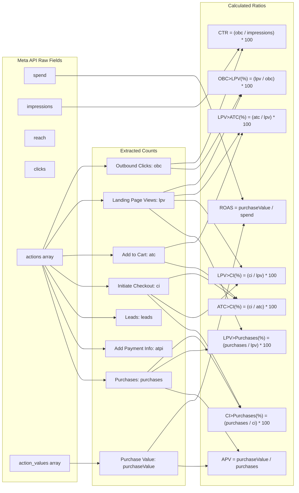

# 13. Vastu Reports Meta Ads Scripts: Deep-Dive Analysis & Ingestion Architecture

## 1. Executive Summary & Security Notice

> [!CAUTION] Security & Credential Hygiene
> The provided Google Apps Scripts contained a hardcoded Meta User Access Token. In accordance with enterprise security standards, **this token will never be printed, logged, committed to source control, or embedded in documentation**. It has been extracted and will be configured strictly via the local `.env` file under the environment variable name `META_ACCESS_TOKEN`.

This document performs an exhaustive architectural and mathematical audit of the two existing Google Apps Scripts:
1. **Script 1 (Daily Batch)**: `runFacebookIngestionPipeline` (Version 2.4.0) — Runs daily at 8:00 AM IST for completed historical days.
2. **Script 2 (Real-Time Intraday)**: `runRealtimeFbIngestion` (Version 2.0.0) — Runs on demand or at frequent intervals for today's live data.

Both scripts target the **Vastu Reports** business area exclusively.

---

## 2. Inventory & Comparison of Both Scripts

### Side-by-Side Technical Comparison

| Dimension | Script 1: Daily Batch Engine (`runFacebookIngestionPipeline`) | Script 2: Real-Time Engine (`runRealtimeFbIngestion`) |
| :--- | :--- | :--- |
| **Execution Trigger** | Automatic time-based trigger at 8:00 AM IST daily. | Manual / on-demand trigger during the day. |
| **Target Ad Account** | `act_845822215217013` (Vastu Reports ad account). | `act_845822215217013` (Identical Vastu ad account). |
| **Date Scope** | Historical date range: `START_DATE = '2026-01-01'` through `END_DATE = YESTERDAY` (strict completed days, excluding today). | Intraday today: `date_preset=today` (live, incomplete current day). |
| **Graph API Version** | Facebook Graph API `v20.0`. | Facebook Graph API `v20.0`. |
| **Aggregation Grain** | Campaign level (`level=campaign`), daily time increment (`time_increment=1`). | Campaign level (`level=campaign`), today's aggregate (`date_preset=today`). |
| **Metadata Calls** | Calls `GET /v20.0/act_<ID>/campaigns?fields=id,created_time` to fetch launch dates. | Identical metadata call to fetch launch dates. |
| **Destination Output** | Google Sheet tab: `vastu_campaign` in spreadsheet "(Alf) Vastu Wheels Daily Data FB". | Google Sheet tab: `vastu_campaign` in spreadsheet "(Alf) Vastu Wheels RealTime FB". |
| **Write Behavior** | Clears row 4 downwards and writes **27 columns** sorted descending by date. | Clears row 4 downwards and writes **26 columns** sorted alphabetically by campaign name. |
| **Column Mismatch** | **Includes Column U (`Leads`)** $\to$ Total 27 columns (A to AA). | **OMITS Column U (`Leads`)** $\to$ Total 26 columns (A to Z). Shift occurs from Column U onward! |

---

## 3. Detailed Column & Mathematical Calculation Mapping

The table below maps the exact fields returned by the Meta API to the calculations performed by the existing scripts:



### Complete Column Breakdown

| Col Index (Daily) | Col Index (Realtime) | Column Header | Data Source / Formula | PostgreSQL Data Type |
| :---: | :---: | :--- | :--- | :--- |
| **A** | **A** | Start Date | `record.date_start` | `DATE` |
| **B** | **B** | End Date | `record.date_stop` (or same as date_start) | `DATE` |
| **C** | **C** | Campaign Name | `record.campaign_name` | `VARCHAR(255)` |
| **D** | **D** | Launch Date | `campaignLaunchDates[campaignId]` (`created_time`) | `TIMESTAMPTZ` or `DATE` |
| **E** | **E** | Spends | `parseFloat(record.spend || 0)` | `NUMERIC(14, 4)` |
| **F** | **F** | ROAS | `spends > 0 ? (purchaseValue / spends) : 0` | `NUMERIC(10, 4)` |
| **G** | **G** | Reach | `parseInt(record.reach || 0)` | `INTEGER` |
| **H** | **H** | Impressions | `parseInt(record.impressions || 0)` | `BIGINT` |
| **I** | **I** | Frequency | `parseFloat(record.frequency || 0)` | `NUMERIC(10, 6)` |
| **J** | **J** | CPM | `parseFloat(record.cpm || 0)` | `NUMERIC(14, 4)` |
| **K** | **K** | Clicks | `parseInt(record.clicks || 0)` | `INTEGER` |
| **L** | **L** | CTR (Outbound) | `impressions > 0 ? ((obc / impressions) * 100) : 0` | `NUMERIC(8, 4)` |
| **M** | **M** | OBC (Outbound Clicks) | Extracted from `outbound_clicks` or `actions` (`outbound_click` / `link_click`) | `INTEGER` |
| **N** | **N** | LPV (Landing Page Views)| Extracted from `actions` (`landing_page_view`) | `INTEGER` |
| **O** | **O** | OBC>LPV (%) | `obc > 0 ? ((lpv / obc) * 100) : 0` | `NUMERIC(8, 4)` |
| **P** | **P** | ATC (Add to Cart) | Extracted from `actions` (`add_to_cart`) | `INTEGER` |
| **Q** | **Q** | LPV>ATC (%) | `lpv > 0 ? ((atc / lpv) * 100) : 0` | `NUMERIC(8, 4)` |
| **R** | **R** | CI (Initiate Checkout) | Extracted from `actions` (`initiate_checkout`) | `INTEGER` |
| **S** | **S** | ATC>CI (%) | `atc > 0 ? ((ci / atc) * 100) : 0` | `NUMERIC(8, 4)` |
| **T** | **T** | LPV>CI (%) | `lpv > 0 ? ((ci / lpv) * 100) : 0` | `NUMERIC(8, 4)` |
| **U** | *(Missing)* | **Leads** | Extracted from `actions` (`lead`) *(Present only in Daily)* | `INTEGER` |
| **V** | **U** | ATPI (Add Payment Info)| Extracted from `actions` (`add_payment_info`) | `INTEGER` |
| **W** | **V** | Purchases | `purchase` / `omni_purchase` / `offsite_conversion.fb_pixel_purchase` | `INTEGER` |
| **X** | **W** | CI>Purchases (%) | `ci > 0 ? ((purchases / ci) * 100) : 0` | `NUMERIC(8, 4)` |
| **Y** | **X** | LPV>Purchases (%) | `lpv > 0 ? ((purchases / lpv) * 100) : 0` | `NUMERIC(8, 4)` |
| **Z** | **Y** | Purchase Value | Extracted from `action_values` (`purchase` / `omni_purchase`) | `NUMERIC(14, 4)` |
| **AA**| **Z** | APV (Avg Purchase Val) | `purchases > 0 ? (purchaseValue / purchases) : 0` | `NUMERIC(14, 4)` |

---

## 4. Key Discovery: Critical Differences & Traps

### 1. The Schema Shift Bug in Google Sheets
In the Google Sheets, the Daily script writes 27 columns (including `Leads` at Column U). The Real-time script omitted `Leads`, writing 26 columns. Because of this, from Column U onwards, the column headers in the two sheets represent different metrics!
- In our PostgreSQL schema, **we store all metrics as explicit named columns**. We never use positional arrays. This permanently solves the column misalignment bug.

### 2. Time Horizon & Overlap Rule
- The **Daily Script** fetches `2026-01-01` to `YESTERDAY` (completed historical dates). Once a day is completed, its metrics are finalized in Meta.
- The **Real-Time Script** fetches `today` (the current active day). Today's spend and conversions change every minute as ads run.
- **Ingestion Rule**:
  - Historical days (`date < CURRENT_DATE`) are written to `meta_campaign_insights_daily`.
  - Today's intraday data (`date = CURRENT_DATE`) is written as a **Real-Time Snapshot** with a snapshot timestamp, and upserted into the daily table as the "latest known progress for today".
  - This ensures re-running the real-time script updates today's record **without creating duplicate days or inflating totals**.

---

## 5. Tailored PostgreSQL Database Schema

Based strictly on the actual fields from the two scripts, here is the minimum appropriate schema for Vastu Reports:

```mermaid
erDiagram
    BUSINESS_UNITS ||--o{ META_AD_ACCOUNTS : "owns"
    META_AD_ACCOUNTS ||--o{ META_CAMPAIGNS : "contains"
    META_CAMPAIGNS ||--o{ META_CAMPAIGN_INSIGHTS_DAILY : "accumulates"
    META_CAMPAIGNS ||--o{ META_REALTIME_SNAPSHOTS : "snapshots"
    META_AD_ACCOUNTS ||--o{ META_SYNC_RUNS : "logs"
    META_SYNC_RUNS ||--o{ META_SYNC_ERRORS : "tracks"

    BUSINESS_UNITS {
        uuid id PK
        varchar_32 code UK "VASTU"
        varchar_128 name "Vastu Reports & Services"
        timestamptz created_at
    }

    META_AD_ACCOUNTS {
        uuid id PK
        uuid business_unit_id FK
        varchar_64 meta_account_id UK "845822215217013"
        varchar_128 name "Vastu Wheels Ad Account"
        varchar_3 currency "INR"
        varchar_64 timezone_name "Asia/Kolkata"
        timestamptz created_at
    }

    META_CAMPAIGNS {
        uuid id PK
        uuid ad_account_id FK
        varchar_64 meta_campaign_id UK
        varchar_255 name
        timestamptz launch_date "Meta created_time"
        timestamptz created_at
        timestamptz updated_at
    }

    META_CAMPAIGN_INSIGHTS_DAILY {
        uuid id PK
        uuid campaign_id FK
        date date UK_COMPOSITE
        numeric spend "NUMERIC(14,4)"
        integer reach
        bigint impressions
        numeric frequency "NUMERIC(10,6)"
        numeric cpm "NUMERIC(14,4)"
        integer clicks
        integer outbound_clicks "OBC"
        integer landing_page_views "LPV"
        integer add_to_cart "ATC"
        integer initiate_checkout "CI"
        integer leads "Leads"
        integer add_payment_info "ATPI"
        integer purchases "Purchases"
        numeric purchase_value "NUMERIC(14,4)"
        numeric roas "Generated / Stored"
        numeric ctr "Generated / Stored"
        numeric apv "Generated / Stored"
        timestamptz created_at
        timestamptz updated_at
    }

    META_SYNC_RUNS {
        uuid id PK
        uuid ad_account_id FK
        varchar_32 script_type "DAILY_BATCH | REALTIME"
        varchar_32 status "STARTED | COMPLETED | FAILED"
        integer records_processed
        timestamptz started_at
        timestamptz completed_at
    }

    META_SYNC_ERRORS {
        uuid id PK
        uuid sync_run_id FK
        varchar_64 error_code
        text error_message
        text error_stack
        timestamptz created_at
    }
```

---

## 6. Mathematical Invariants & Stored vs Computed Ratios

In database design, storing raw metrics versus calculated ratios requires careful discipline:
1. **Raw Core Metrics (Always Stored)**:
   - `spend`, `reach`, `impressions`, `frequency`, `cpm`, `clicks`, `outbound_clicks`, `landing_page_views`, `add_to_cart`, `initiate_checkout`, `leads`, `add_payment_info`, `purchases`, `purchase_value`.
2. **Calculated Ratios**:
   - `roas = purchase_value / spend` (handling division by zero $\to$ `0`).
   - `ctr = (outbound_clicks / impressions) * 100`.
   - `obc_lpv_pct = (landing_page_views / outbound_clicks) * 100`.
   - `lpv_atc_pct = (add_to_cart / landing_page_views) * 100`.
   - `atc_ci_pct = (initiate_checkout / add_to_cart) * 100`.
   - `lpv_ci_pct = (initiate_checkout / landing_page_views) * 100`.
   - `ci_purchase_pct = (purchases / initiate_checkout) * 100`.
   - `lpv_purchase_pct = (purchases / landing_page_views) * 100`.
   - `apv = purchase_value / purchases`.
3. **Storage Strategy**:
   - We store both the raw numbers **and** the pre-computed ratios in PostgreSQL so SQL queries can return the exact sheet format instantly without re-calculating formulas every time.
   - When aggregating across campaigns or date ranges in SQL, we **sum the raw numbers first** and then apply the formula (e.g. `SUM(purchase_value) / SUM(spend)`), avoiding the statistical error of "averaging percentages".

---

## 7. Missing Information & Items Requiring Clarification

1. **Meta Token Expiration**: The access token provided in the scripts appears to be a User Access Token. Does it have an expiration date (e.g., 60 days), or has a permanent System User Token been generated in Meta Business Manager?
2. **PostgreSQL Installation**: Native PostgreSQL installer needs to be installed on your Windows machine before migrations can run.
