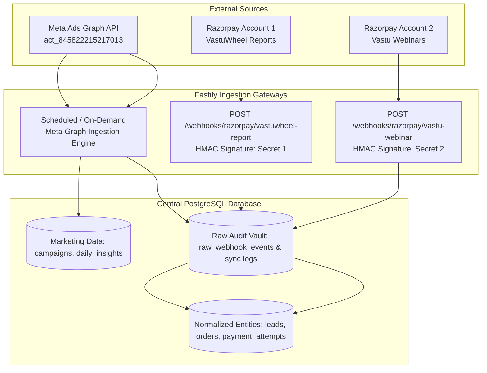
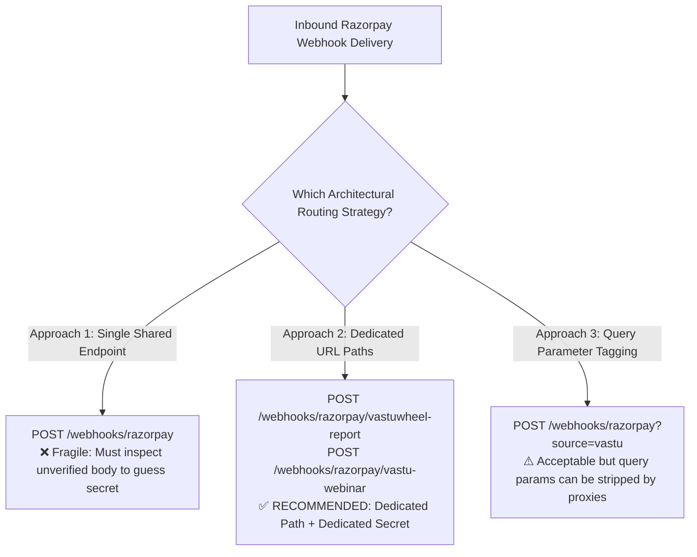
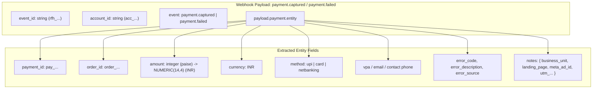
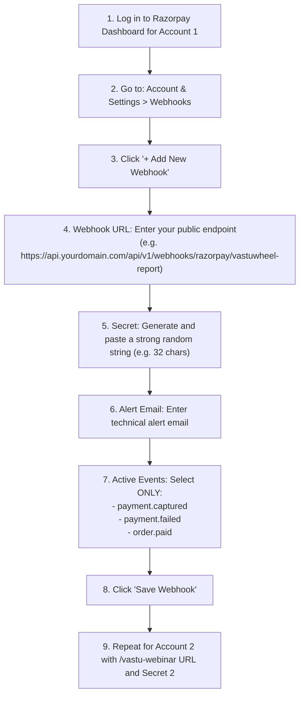

# 14. Data Sources Integration Blueprint & Ingestion Architecture

## 1. Executive Summary & Architectural Scope

This blueprint defines the unified data integration strategy for our **Lead Management Platform**. It establishes how marketing performance data (**Meta Ads**) and commercial financial transactions (**Two Razorpay Accounts**) flow into a single, authoritative PostgreSQL database without cross-contaminating business identities, double-counting metrics, or compromising security.



### Core Ingestion Tenets
1. **Single Central Database, Strict Logical Partitioning**: We do not create separate databases for different webhooks or sources. All data lands in one PostgreSQL database, strictly isolated using immutable source tags: `business_unit`, `source_system`, `source_account`, and `webhook_name`.
2. **Zero Secret Leakage**: Razorpay Webhook Secrets and Meta Access Tokens exist solely in private local environment variables (`.env`). They are never printed in logs, exposed in API responses, or committed to Git.
3. **Cryptographic Verification Before Storage**: Webhook payloads are accepted only if their `X-Razorpay-Signature` HMAC-SHA256 header matches the calculated hash using that source's specific webhook secret. Unsigned or mismatched payloads are rejected with HTTP 400 immediately.
4. **Immutable Raw Payload Vault**: Every inbound webhook and API response is archived in a raw audit table before downstream business logic executes. If downstream logic changes or bugs occur, historical data can be re-parsed without data loss.
5. **Exact Separation of Payment States**: A created checkout or open modal is never a captured payment. Captured payments and failed payments are stored as distinct payment attempt records.

---

## 2. Complete Data Source Inventory

| Source Identifier | Business Area | Source System | Ingestion Mechanism | Target Account ID | Source Frequency | Ingestion Status |
| :--- | :--- | :--- | :--- | :--- | :--- | :--- |
    | `meta_ads_vastu` | Vastu Reports | Meta Marketing API (v20.0) | Outbound Pull (HTTP GET / pagination) | `act_845822215217013` | Daily at 8:00 AM IST + Realtime Intraday | **Audited & Planned** (Scripts Audited) |
    | `rzp_vastuwheel_report` | VastuWheel Reports | Razorpay Payment Gateway | Inbound Push (HTTP POST Webhook) | `[PENDING: Merchant ID 1]` | Real-time event-driven | **Configured** |
    | `rzp_vastu_webinar` | Vastu Webinars | Razorpay Payment Gateway | Inbound Push (HTTP POST Webhook) | `[PENDING: Merchant ID 2]` | Real-time event-driven | **Configured** |
| `rzp_vastu_consultancy` | Vastu Consultancy | Razorpay Payment Gateway | Inbound Push (HTTP POST Webhook) | `[PENDING: Merchant ID 3]` | Real-time event-driven | **Configuring Now** |

---

## 3. The Webhook Identification Problem & Architectural Solution

### The Technical Trap
In the Razorpay Dashboard, an administrator assigns a human-friendly name to a webhook (e.g. `"vastuwheel_report"`). However:
> [!WARNING] Razorpay Payload Reality
> **Razorpay never sends your webhook's display name inside the webhook JSON payload.**
> A raw Razorpay webhook payload contains:
> - `event`: e.g. `"payment.captured"`
> - `account_id`: e.g. `"acc_L3k9J2m1..."` (the internal Razorpay Merchant Account ID)
> - `payload`: containing `payment` or `order` entities.
>
> If you create a single generic endpoint (`/webhooks/razorpay`), your server has no reliable way to verify the HMAC signature without guessing which secret to use, or comparing account IDs against a hardcoded lookup table.

### Evaluated Identification Approaches




### The Recommended Architecture: Dedicated Endpoint Paths + Dedicated Secrets
We will establish two explicit, independent webhook routes in Fastify:
1. `POST /api/v1/webhooks/razorpay/vastuwheel-report`
   - Verified strictly using: `RAZORPAY_WEBHOOK_SECRET_VASTUWHEEL`
   - Injected Context: `business_unit = 'VASTU'`, `source_account = 'RZP_VASTUWHEEL'`, `webhook_name = 'vastuwheel_report'`
2. `POST /api/v1/webhooks/razorpay/vastu-webinar`
   - Verified strictly using: `RAZORPAY_WEBHOOK_SECRET_WEBINAR`
   - Injected Context: `business_unit = 'WEBINAR'`, `source_account = 'RZP_WEBINAR'`, `webhook_name = 'vastu_webinar'`

#### Why this is the safest practical approach:
- **Instant Cryptographic Isolation**: The endpoint immediately knows which secret to compute the HMAC hash with. It never has to parse an untrusted body or guess credentials.
- **Fail-Fast Security**: If a webhook intended for Webinars hits the VastuWheel endpoint, signature verification fails instantly and returns HTTP 400.
- **Independent Key Rotation**: If one Razorpay account compromises or rotates its webhook secret, the other business unit continues operating with zero downtime.

---

## 4. Razorpay Events & Source-to-Field Mapping

### Target Webhook Events
We will subscribe to three essential events in each Razorpay account:
1. `payment.captured`: Customer successfully paid and funds are secured.
2. `payment.failed`: Payment attempt failed (e.g. insufficient funds, OTP expired, bank timeout, card declined).
3. `order.paid`: Gateway order marked fully paid (signals completion of order level).



### Detailed Field Mapping Table

| Razorpay JSON Path | Target Database Column | Data Type | Purpose & Handling Rules |
| :--- | :--- | :--- | :--- |
| `event` | `event_type` | `VARCHAR(64)` | `payment.captured`, `payment.failed`, `order.paid` |
| Header: `x-razorpay-event-id` | `gateway_event_id` | `VARCHAR(64)` | Unique Razorpay event ID for **replay protection & deduplication**. |
| `account_id` | `source_merchant_id` | `VARCHAR(64)` | Official Razorpay Merchant ID (`acc_XXXXX`). |
| `payload.payment.entity.id` | `gateway_payment_id` | `VARCHAR(64)` | Payment attempt ID (`pay_XXXXX`). Unique per attempt. |
| `payload.payment.entity.order_id` | `gateway_order_id` | `VARCHAR(64)` | Gateway order ID (`order_XXXXX`). |
| `payload.payment.entity.amount` | `amount` | `NUMERIC(14,4)` | **Converted from Paise to Rupee**: `amount_in_paise / 100`. |
| `payload.payment.entity.currency` | `currency` | `VARCHAR(3)` | Billing currency (`INR`, `USD`). |
| `payload.payment.entity.status` | `attempt_status` | `VARCHAR(32)` | `captured`, `failed`, `authorized`. |
| `payload.payment.entity.method` | `payment_method` | `VARCHAR(32)` | `upi`, `card`, `netbanking`, `wallet`. |
| `payload.payment.entity.contact` | `customer_phone` | `VARCHAR(32)` | E.164 normalized phone number for lead canonicalization. |
| `payload.payment.entity.email` | `customer_email` | `VARCHAR(255)` | Normalized customer email address. |
| `payload.payment.entity.error_code` | `error_code` | `VARCHAR(64)` | Failure reason code (e.g. `BAD_REQUEST_ERROR`). Null if captured. |
| `payload.payment.entity.error_description`| `error_description`| `TEXT` | Detailed failure reason message from issuing bank. |
| `payload.payment.entity.notes` | `client_metadata` | `JSONB` | Embedded custom parameters (`landing_page`, `meta_ad_id`, UTMs). |

---

## 5. Webhook Reliability: Retries, Duplicates, Retries, and Failures

### 1. Webhook Deduplication & Idempotency
- **The Problem**: Razorpay guarantees *at-least-once* delivery. If our server takes > 5 seconds to answer or a network blip occurs, Razorpay retries the exact same webhook up to 24 hours.
- **The Solution**:
  1. Incoming webhook headers provide `X-Razorpay-Event-Id`.
  2. The raw vault enforces `UNIQUE (gateway_event_id)`.
  3. If a duplicate `gateway_event_id` arrives:
     - The raw vault acknowledges it without re-processing downstream business logic.
     - The endpoint immediately returns `HTTP 200 OK` to stop Razorpay from retrying.

### 2. Multi-Attempt Payment Reconciliation (Scenario B)
- **The Problem**: A customer attempts to pay for a Vastu Report. Attempt 1 fails (UPI timeout). They immediately retry and Attempt 2 succeeds.
- **The Multiplicity Rule**:
  - `1 Customer (Lead)` $\to$ `1 Order (₹1,499 Vastu Report)` $\to$ `2 Payment Attempts`:
    - Attempt 1: `pay_A1B2C3` $\to$ Status: `FAILED`, Error: `PAYMENT_TIMED_OUT`
    - Attempt 2: `pay_X9Y8Z7` $\to$ Status: `CAPTURED`, Amount: `1499.00`
  - The Order status transitions: `PENDING` $\to$ `PAID`.
  - **Zero Duplicate Leads**: The lead was established at form submission.
  - **Zero Lost Audit Trail**: Attempt 1 remains permanently in `payment_attempts` for drop-off analysis.

---

## 6. How Meta Ads and Razorpay Meet in the Central Database

How does Meta ad spend connect to verified Razorpay revenue?

```mermaid
graph LR
    subgraph Meta Ads Ingestion
        M_CAMP[meta_campaigns]
        M_AD[meta_ads: meta_ad_id = 12020584...]
        M_SPEND[meta_campaign_insights_daily: spend = 3000.18]
    end

    subgraph Landing Page & Checkout
        LP[Landing Page: vastu-audit.com]
        FORM[Form Submit with UTMs & meta_ad_id]
        RZP_ORDER[Razorpay Order Created with notes: { meta_ad_id, bu: 'VASTU' }]
    end

    subgraph Razorpay Ingestion
        PAY_CAPT[Webhook: payment.captured]
        ATTEMPT[payment_attempts: status = 'CAPTURED']
        ORD[orders: total_amount = 1499.00, status = 'PAID']
    end

    subgraph Unified Reporting Queries
        ROAS_CALC["True Business ROAS = Sum(orders.total_amount) / Sum(meta_spend)"]
    end

    M_AD -.->|Clicked by User| LP
    LP --> FORM --> RZP_ORDER --> PAY_CAPT --> ATTEMPT --> ORD
    M_SPEND --> ROAS_CALC
    ORD --> ROAS_CALC
```

### The Attribution Bridge (`notes` Object)
When our landing page or backend creates a Razorpay order before opening checkout, it injects structured metadata into Razorpay's `notes` parameter:
```json
{
  "business_unit": "VASTU",
  "product_code": "VASTU_REPORT_DIGITAL",
  "landing_page_url": "https://vastuwheel.com/report-special",
  "meta_ad_id": "1202058493029102",
  "utm_source": "meta_ads",
  "utm_campaign": "VW_Report_CT_Sales_ABO"
}
```
When Razorpay sends the `payment.captured` webhook, this `notes` object returns intact inside `payload.payment.entity.notes`. Our ingestion engine extracts `meta_ad_id` and links the verified cash directly to the ad creative that generated it!

---

## 7. Required Checklist & Action Plan

### Section A: What Is Already Known & Audited
1. **Vastu Meta Ad Account**: `act_845822215217013`.
2. **Meta Graph API Version**: `v20.0` (compatible with `v21.0`).
3. **Meta Fields & Calculations**: 27 metrics verified, including exact formulas for ROAS, CTR, OBC, LPV, ATC, CI, ATPI, Purchases, and APV.
4. **Local Database Engine**: PostgreSQL 16 running on `localhost:5432` and verified via pgAdmin 4.

---

### Section B: What Is Still Required for Razorpay Source 1 (VastuWheel Reports)
- [ ] **Account Display Name**: (e.g. "VastuWheel Commercial Account")
- [ ] **Razorpay Merchant ID**: The public account ID starting with `acc_...` (visible in Razorpay Dashboard top-left).
- [ ] **Webhook Secret**: A secure 32-character random string generated specifically for the VastuWheel webhook.
- [ ] **Target Landing Page URLs**: The specific domains sending traffic to this Razorpay account.

---

### Section C: What Is Still Required for Razorpay Source 2 (Vastu Webinars)
- [ ] **Account Display Name**: (e.g. "Vastu Webinars Account")
- [ ] **Razorpay Merchant ID**: The public account ID starting with `acc_...`.
- [ ] **Webhook Secret**: A separate, distinct 32-character random string generated specifically for the Webinar webhook.
- [ ] **Target Landing Page URLs**: The specific domains sending traffic to this Webinar account.

---

### Section D: Step-by-Step Guide to Configure Webhooks in Razorpay Dashboard

For **both** Razorpay accounts, follow these exact steps inside the Razorpay Dashboard:



> [!TIP] Local Testing Note
> During local development, Razorpay webhooks running on the cloud cannot directly reach `http://localhost:3000`. When we reach the live webhook testing phase, we will use a secure reverse tunnel (such as **ngrok** or **Cloudflare Tunnels**) to route test events to your local Fastify server. You do not need to configure this today.

---

### Section E: Database Design Decisions to Defer Until Confirmation
The following items remain intentionally deferred until source account IDs and sample payloads are verified:
1. Exact structure of the product catalog table (single price vs tiered pricing).
2. Customer GST / Tax invoice fields on orders.
3. Refund and chargeback webhook event structures (`refund.processed`, `payment.disputed`).
4. Custom landing page webhook payloads (prior to checkout opening).
